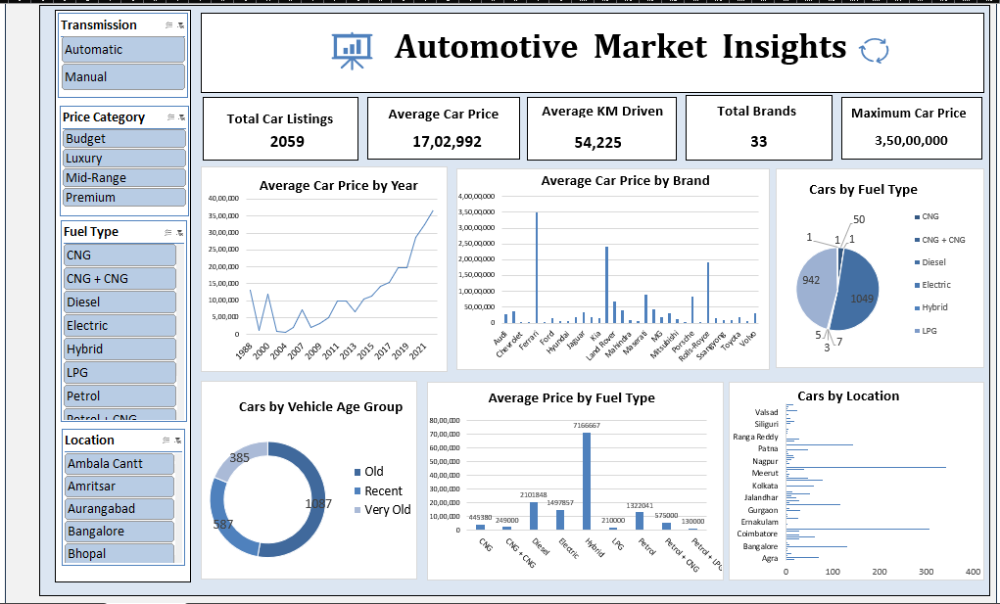

# Data Cleaning, Analysis & Interactive Dashboard using Microsoft Excel

## Project Overview
This project focuses on data cleaning, data analysis, and visualization using Microsoft Excel. It demonstrates how raw data can be transformed into meaningful insights through Excel functions, Pivot Tables, and dashboard visualizations.

## Tools & Technologies
- Microsoft Excel
- Pivot Tables
- Excel Formulas
- Data Cleaning
- Data Visualization
- Charts and Dashboards

## Project Objectives
- Clean and organize raw datasets.
- Handle missing and inconsistent values.
- Perform data analysis using Excel formulas.
- Summarize data using Pivot Tables.
- Create meaningful charts and dashboards.
- Generate insights to support data-driven decisions.

## Key Features
- Data cleaning and formatting
- Data analysis using Excel functions
- Pivot Table analysis
- Interactive dashboard
- Data visualization

## Dashboard Preview

## Dashboard Preview

### Excel Data Analysis Dashboard

Add your Excel dashboard screenshots here.

## Project Files
- Excel workbook (.xlsx)
- Dashboard screenshots

## Conclusion
This project demonstrates practical skills in Excel data cleaning, data analysis, reporting, and dashboard development.
